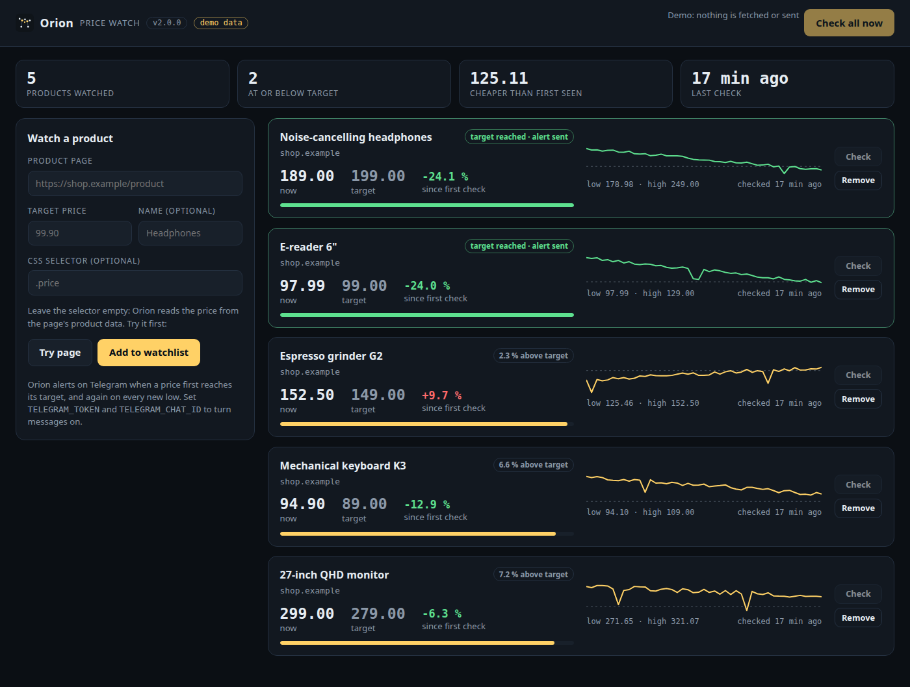
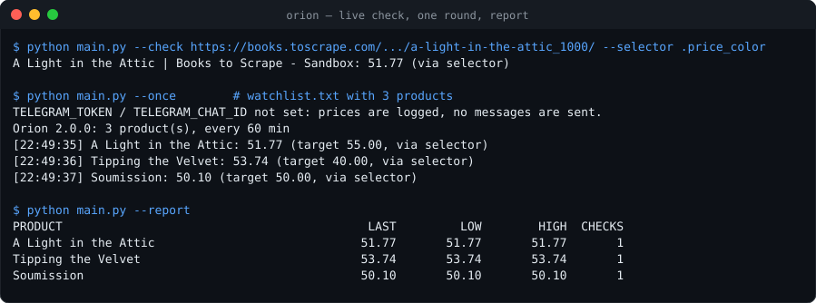
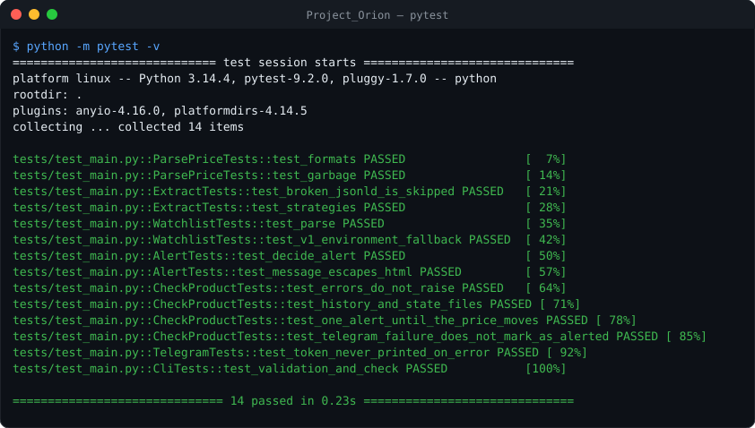
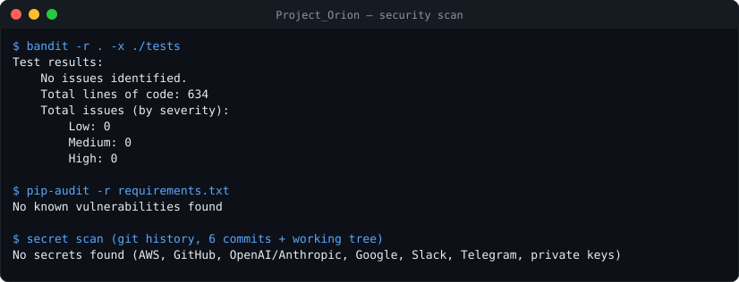

# 👁️ Project Orion

> *"Perception is the beginning of control."*

[](https://github.com/fas0ftware/Project_Orion/actions/workflows/ci.yml)


Orion watches product pages and sends you a **Telegram message when a price drops** to your target. The first automation project of **FA Software**.



<sub>Orion Web with `--demo`: a fictional shop and generated prices.</sub>

## Features

- **Many products** in `watchlist.txt`, each with its own target price, optional CSS selector and display name.
- **Works on most shops without configuration:** finds the price in schema.org **JSON-LD**, then `product:price:amount` / `og:price:amount` meta tags, then `itemprop="price"`, then your CSS selector or class.
- **Any price format:** `35.499,90 TL`, `₺1.299`, `$1,299.99`, `1 299,00 €`, `CHF 1'299.50`.
- **No spam:** one message when the price first reaches the target, another only for a **new low**; a price that goes back above the target re-arms the alert. State survives restarts (`orion_state.json`).
- **Price history** in `price_history.csv` and a `--report` with last / low / high per product.
- **Orion Web** (`python web.py`): the watchlist in the browser. Add a product after trying the page, see every price against its target with its history, check now, remove. Same files as the checker, so both can run together.
- `--once` for cron or systemd timers, `--check URL` to test a page before adding it.
- Safe by default: 20 s timeouts, 5 MB page limit, HTML-escaped messages, the bot token never appears in logs, CSV cells cannot become spreadsheet formulas, at least 5 minutes between rounds.

## Setup

```bash
pip install -r requirements.txt
cp watchlist.example.txt watchlist.txt     # URL | target | CSS selector (optional) | name (optional)
export TELEGRAM_TOKEN=... TELEGRAM_CHAT_ID=...   # from @BotFather and getUpdates; optional
```

Without the Telegram variables Orion still checks and logs prices.

## Usage

```bash
python main.py --check "https://shop.example/product/123"     # what does Orion see on this page?
python main.py --once                                         # one round (cron: */60 * * * *)
python main.py --interval 30                                  # run forever, every 30 minutes
python main.py --report
```



<sub>Terminal demo against books.toscrape.com, a site built for scraping practice.</sub>

### Web interface

```bash
python web.py            # http://127.0.0.1:8741, uses watchlist.txt in this folder
python web.py --demo     # fictional products and price history; nothing is fetched or sent
```

It listens on 127.0.0.1 only, accepts changes only from its own page (Host and Origin
checks against DNS rebinding and cross-site requests), sends a strict Content-Security-Policy
and shows shop text only as text. Fields are validated before they are written to
`watchlist.txt`, so a URL or name cannot add or break watchlist lines.

The v1 single-product variables (`ORION_URL`, `ORION_TARGET_PRICE`, `ORION_PRICE_CLASS`) still work when no `watchlist.txt` exists. Pages that only render their price with JavaScript cannot be read this way.

## Tests

22 tests, network mocked: price formats, all four extraction strategies, broken JSON-LD, watchlist validation, alert de-duplication across price changes, history and state files, formula-injection guard, oversized pages and network errors, token-safe error messages, the CLI; the web interface (watchlist edits, hostile fields, a check against a fake shop, demo mode never fetching, Host/Origin/content-type guards, static file paths).

```bash
pip install -r requirements-dev.txt
python -m pytest -v
```





## Notes

Check a shop's terms of use before monitoring it, keep the interval reasonable, and never use automated purchases or high-frequency polling.

## Changelog

- **2.1.0** – Orion Web: local browser interface for the watchlist (add with a page preview, price vs. target with history, check now, remove) and a `--demo` mode.
- **2.0.0** – Watchlist with many products, JSON-LD/meta/itemprop/CSS price detection, international price formats, alert only on target or new low, persistent state, price history and report, `--once`/`--check`/`--report`, page size limit, HTML-escaped messages, pytest suite, CI with bandit + pip-audit.
- **1.0.0** – One product, one CSS class, Telegram alert on every check below target.

---

Part of the **FA Software** projects. Licensed under the [MIT License](LICENSE).
